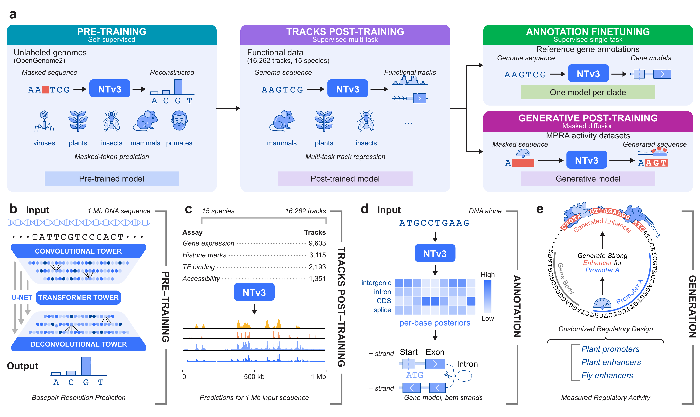
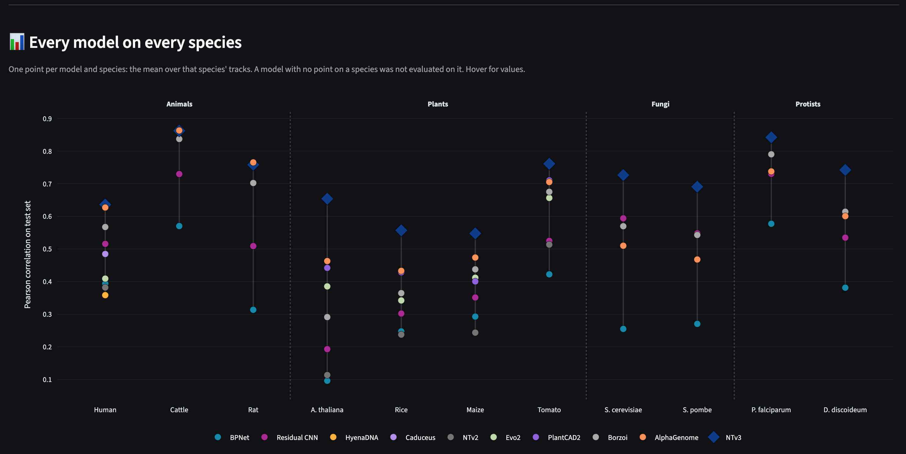

# 🧬 Nucleotide Transformer v3 (NTv3)

The Nucleotide Transformer v3 (NTv3) is a **multi-species genomics foundation model** that unifies representation learning, functional-track prediction, genome annotation, and controllable sequence generation within a single framework. Unlike existing specialized approaches, NTv3 combines **long-context modeling (up to 1 Mb)**, **base-resolution prediction**, and **controllable generation** across organisms and modalities.

NTv3 uses a **U-Net-like architecture** with **single-base tokenization**, enabling efficient processing of million-nucleotide contexts at nucleotide resolution. We pretrain on **9 trillion base pairs** from OpenGenome2 using masked language modeling, followed by post-training with a joint objective that integrates continued self-supervision with supervised learning on **16,262 functional tracks** and annotation labels from **15 animal and plant species**.

After post-training, NTv3 achieves **state-of-the-art accuracy** for functional-track prediction and genome annotation, outperforming leading baselines on established benchmarks and on **NTv3 Benchmark (NTv3Bench)**, our new controlled fine-tuning suite with 32 kb inputs and base-resolution outputs. We further demonstrate that NTv3 can be fine-tuned into a **controllable generative model** via masked diffusion, enabling design of enhancer sequences with specified activity levels—validated experimentally via STARR-seq *in cellulo*.


---

<p align="center">
  <strong>📜 <a href="https://www.biorxiv.org/content/10.64898/2025.12.22.695963">Read the Paper</a></strong> &nbsp;•&nbsp;
  <strong>🚀 <a href="https://huggingface.co/spaces/InstaDeepAI/ntv3">Hugging Face Space</a></strong> &nbsp;•&nbsp;
  <strong>🗒️ <a href="../notebooks/nucleotide_transformer_v3">JAX Notebook Tutorials</a></strong> &nbsp;•&nbsp;
  <strong>🧪 <a href="#-ntv3-benchmark">NTv3 Benchmark</a></strong>
</p>

---

<p align="center">
  
</p>

<p align="center"><em><strong>Overview:</strong> one U-Net backbone, pretrained by masked-token prediction on unlabeled genomes, then specialised into the released capabilities. A convolutional tower reads the sequence, a transformer tower carries long-range context up to 1 Mb, and a deconvolutional tower returns predictions at single-base resolution. Tracks post-training gives functional-track prediction, annotation fine-tuning gives <em>ab initio</em> gene calling per clade, and generative post-training by masked diffusion gives controllable enhancer design.</em></p>

---

The `nucleotide_transformer_v3` package loads the released models from their
Flax weights. This page covers the pretrained and tracks models:

- **NTv3 pretrained**: the backbone with its masked-language-model head, for
  embeddings and masked-token prediction.
- **NTv3 tracks**: the same backbone with a species-conditioned head predicting
  7,362 functional-genomics tracks (bigwig signal) at single-base resolution.

```python
from nucleotide_transformer_v3.pretrained import load_pretrained_model, load_tracks_model

model, tokenizer = load_pretrained_model("NTv3_pretrained")
model, tokenizer, (species_tokenizer,) = load_tracks_model("NTv3_tracks")
```

The three genome-annotation models (`NTv3_annot_mammals`, `NTv3_annot_plants`,
`NTv3_annot_insects`) load with `load_annotation_model`; see
[ntv3_genome_annotation.md](./ntv3_genome_annotation.md).

> [!NOTE]
> Earlier versions of this package loaded the `NTv3_*_pre` / `NTv3_*_post`
> checkpoints (`NTv3_100M_pre`, `NTv3_650M_post`, ...), which use a different
> architecture. That code has been removed from `main`. It is still available at
> commit [`2dc37b8`](https://github.com/instadeepai/nucleotide-transformer/tree/2dc37b86e16a6970fbc731751f7719d9f676f7f9):
> [package](https://github.com/instadeepai/nucleotide-transformer/tree/2dc37b86e16a6970fbc731751f7719d9f676f7f9/nucleotide_transformer_v3) ·
> [docs](https://github.com/instadeepai/nucleotide-transformer/blob/2dc37b86e16a6970fbc731751f7719d9f676f7f9/docs/nucleotide_transformer_v3.md) ·
> [notebooks](https://github.com/instadeepai/nucleotide-transformer/tree/2dc37b86e16a6970fbc731751f7719d9f676f7f9/notebooks/nucleotide_transformer_v3)
>
> That commit installs the same `nucleotide_transformer` distribution and the same
> `nucleotide_transformer_v3` module as `main`, so install it in a separate environment.

---

## 📑 Table of Contents

1. [🎯 Training Overview](#-training-overview)
2. [✨ Key Capabilities](#-key-capabilities)
3. [📦 Models](#-models)
4. [⬇️ Where the weights come from](#️-where-the-weights-come-from)
5. [🏗️ Architecture](#️-architecture)
6. [🔤 Tokenization: the two models differ](#-tokenization-the-two-models-differ)
7. [📏 Window and crop](#-window-and-crop)
8. [🐍 Pretrained model](#-pretrained-model)
9. [🐍 Tracks model](#-tracks-model)
10. [🧬 Genome annotation](#-genome-annotation)
11. [🧪 Verification](#-verification)
12. [⚖️ Known limitations](#️-known-limitations)
13. [🧪 NTv3 Benchmark](#-ntv3-benchmark)
14. [📚 Citing Our Work](#-citing-our-work)
15. [🕰️ The initial release (2025)](#️-the-initial-release-2025)

---

## 🎯 Training Overview

NTv3 is trained in two stages:

1. **Pre-training:** Trained on **9 trillion base pairs** from OpenGenome2 using base-resolution masked language modeling (MLM), scaling context to 1 Mb through a length curriculum and mixed-length training.

2. **Post-training:** Joint objective integrating continued self-supervision with supervised learning on **16,262 functional tracks** and annotation labels from **15 animal and plant species**.

> [!TIP]
> After post-training, NTv3 achieves **state-of-the-art accuracy** for functional-track prediction and genome annotation across species, outperforming leading sequence-to-function and foundation-model baselines. Notably, NTv3 is the **first sequence-to-function-at-scale model extended to the plant regime**, enabling base-resolution prediction of ~6,000 functional tracks across key plant species.

---

## ✨ Key Capabilities

| | Capability | Description |
|:---:|:---|:---|
| 🧬 | **Self-Supervised Genome Modeling** | Via masked language modeling, yielding representations and variant-effect probabilities for comprehensive genome understanding. |
| 📊 | **Supervised Genome-to-Function Prediction** | Functional-track heads enable prediction of **~16,000 tracks across 24 species**, covering chromatin accessibility, histone modifications, and transcription factor binding. |
| 🎯 | **Base-Resolution Genome Annotation** | Segmentation heads provide precise, base-resolution genome-annotation prediction for gene elements and regulatory regions. |
| 🎨 | **Controllable Generative Modeling** | Fine-tune NTv3 into a controllable generative model through the masked-diffusion language modeling (MDLM) paradigm for sequence design tasks. |

---

## 📦 Models

| Name | Class | Parameters | Vocabulary | Outputs |
| --- | --- | --- | --- | --- |
| `NTv3_pretrained` | `NTv3` | 703,349,146 | 11 tokens, uppercase only | `logits`, `embedding`, `after_transformer_embedding`, `before_transformer_embedding` |
| `NTv3_tracks`, `NTv3_tracks_1mb` | `DiscreteConditionedNTv3WithTracksHeads` | 711,256,680 each | 16 tokens, soft-masked | `bigwig_tracks_logits`, `species_logits`, `logits`, `embedding`, both transformer embeddings |
| `NTv3_annot_mammals`, `NTv3_annot_plants`, `NTv3_annot_insects` | `NTv3WithTracksHeads` | 703,446,690 each | 16 tokens, soft-masked | `bed_tracks_logits` over 15 annotation states, plus the embeddings |

Both share one backbone geometry: a U-Net with 6 downsampling blocks around a
14-layer transformer (embedding dim 2048, 8 query heads, 2 key/value heads).
The tracks models have no BED / annotation head. `NTv3_tracks` takes inputs of
16 kb to 1 Mb; `NTv3_tracks_1mb`, the 1 Mb specialist it was finetuned from, was
trained on 1 Mb inputs only.

## ⬇️ Where the weights come from

Each name resolves to the `jax_model/` subfolder of a Hugging Face repository,
downloaded into the Hugging Face cache on first use:

| Name | Repository | Files in `jax_model/` |
| --- | --- | --- |
| `NTv3_pretrained` | [`InstaDeepAI/NTv3_pretrained`](https://huggingface.co/InstaDeepAI/NTv3_pretrained) | `hyperparameters.json`, `flax_model.msgpack`, `tokenizer_config.json` |
| `NTv3_tracks` | [`InstaDeepAI/NTv3_tracks`](https://huggingface.co/InstaDeepAI/NTv3_tracks) | the same, plus `conditions_tokenizers.json` |
| `NTv3_tracks_1mb` | [`InstaDeepAI/NTv3_tracks_1mb`](https://huggingface.co/InstaDeepAI/NTv3_tracks_1mb) | the same as `NTv3_tracks` |

`load_annotation_model` resolves `NTv3_annot_mammals`, `NTv3_annot_plants` and
`NTv3_annot_insects` the same way; see
[ntv3_genome_annotation.md](./ntv3_genome_annotation.md) for those models. Every
download also fetches the export's `roundtrip_fixture.npz` (164 KB for the
pretrained model, 40 MB for tracks), which `check_release` replays.

The same repositories carry the PyTorch weights at their root. They are gated:
request access on any of their Hub pages, where one approval covers all of them,
then run `huggingface-cli login`.

Every loader also takes a local directory holding those files, and a
`revision=` to pin a Hub commit. Loading from a directory never imports
`huggingface_hub`.

The loaders refuse artifacts that do not match the model they build: a
variable that is missing, left over or at the wrong shape; tracks weights
passed to `load_pretrained_model`; a tracks model whose species conditioning
was stripped; a tokenizer whose size disagrees with the model. Each of these
would otherwise load and predict wrong without raising.

---

## 🏗️ Architecture

NTv3 employs a U-Net-like architecture optimized for long-range genomic modeling:

1. **Single-base tokenization:** each nucleotide is its own token, for true base-pair resolution.
2. **Convolutional downsampling tower:** an initial 2x pool followed by `num_downsamples` blocks that each halve the length, so the sequence shrinks by `config.total_downsampling = 2 ** (num_downsamples + 1)`, 128 for the released models.
3. **Transformer core:** grouped-query self-attention over the compressed representation.
4. **Deconvolutional upsampling tower:** restores the original resolution with skip connections.
5. **Species conditioning (tracks model):** a species embedding FiLM-modulates the bigwig head; the trunk itself is not conditioned.

This design enables **efficient processing of sequences up to 1 Mb** while maintaining **single-nucleotide resolution outputs**.

---

## 🔤 Tokenization: the two models differ

| | `NTv3_pretrained` | `NTv3_tracks` |
| --- | --- | --- |
| Vocabulary | `<unk> <pad> <mask> <cls> <eos> <bos> A T C G N` | the same, plus `a t c g n` (ids 11-15) |
| Soft-masked (lowercase) input | **uppercase it first** | **keep it**: the model was trained on repeat-masked assemblies |

**The pretrained vocabulary has no lowercase bases.** On a soft-masked
sequence, which is most of any UCSC or Ensembl FASTA, `tokenizer.tokenize`
returns `<unk>` for every lowercase base without any error.

`np_tokenize` / `batch_np_tokenize` are worse: they stop at the first
character outside the vocabulary. With NumPy < 2.3 they **silently return a
truncated array** (`"ACGTacgtACGT"`, 12 bp, comes back as `[6, 8, 9, 7, 0]`),
and with NumPy 2.3 and later they raise an unhelpful `ValueError`. Check the
token count against the sequence length after tokenizing.

Neither vocabulary has IUPAC ambiguity codes (`R`, `Y`, ...), so map them to
`N` (or `n`, to keep a soft mask) before tokenizing:

```python
import re

pretrained_seq = re.sub(r"[^ACGTN]", "N", seq.upper())
tracks_seq = re.sub(r"[^ACGTNacgtn]", lambda m: "n" if m.group().islower() else "N", seq)

tokens = tokenizer.batch_np_tokenize([pretrained_seq])
assert tokens.shape[1] == len(pretrained_seq)  # catches a silent truncation
```

## 📏 Window and crop

- **Length.** Any sequence length that is a multiple of 128 works
  (`config.total_downsampling`). Both models were released at **1,048,576 bp**.
  That value is declared, not enforced: it is recorded in
  `hyperparameters.json` under `provenance.released_sequence_length`, and the
  architecture itself stores no length.
- **Crop (tracks only).** `bigwig_tracks_logits` covers the central
  `keep_target_center_fraction = 0.375` of the input: `int(0.375 * L)` positions,
  so **393,216 bp** of a 1 Mb window, starting `int(0.3125 * L)` bp into it.
  The LM `logits` and `embedding` stay full length.

## 🐍 Pretrained model

```python
import jax.numpy as jnp
from nucleotide_transformer_v3.pretrained import load_pretrained_model

model, tokenizer = load_pretrained_model("NTv3_pretrained")  # bf16 compute by default

tokens = jnp.asarray(tokenizer.batch_np_tokenize([seq.upper()]))  # (batch, L)

outs = model(tokens)
outs["logits"]                       # (batch, L, 11)
outs["embedding"]                    # (batch, L, 1024), single-base resolution
outs["after_transformer_embedding"]  # (batch, L / 128, 2048), transformer trunk

embeddings = model(tokens, skip_lm_head=True)  # same, without the LM projection
```

Masked-token prediction: replace positions with `tokenizer.mask_token_id` and
read `logits` there. Notebook:
[inference_pretrained.ipynb](../notebooks/nucleotide_transformer_v3/inference_pretrained.ipynb).

## 🐍 Tracks model

```python
import jax.numpy as jnp
from nucleotide_transformer_v3.pretrained import load_tracks_model

model, tokenizer, (species_tokenizer,) = load_tracks_model("NTv3_tracks")
config = model.config

tokens = jnp.asarray(tokenizer.batch_np_tokenize([seq]))            # soft mask kept
species = jnp.asarray([species_tokenizer.token_to_id("human")])      # one id per sequence

hg38 = config.bigwigs_per_file_assembly["hg38"]
track_indices = jnp.asarray([hg38.index("ENCSR000AKO"), hg38.index("ENCSR921NMD")])

outs = model(tokens, [species], track_indices=track_indices, skip_lm_head=True)
outs["bigwig_tracks_logits"]  # (batch, int(0.375 * L), len(track_indices))
```

### Always pass `track_indices`

The head is 7,362 tracks wide at single-base resolution. Without
`track_indices` it computes every track at every position: at 1 Mb that output
alone is 7,362 × 393,216 float32 values, **~10.8 GiB per sequence**, before
any activation. With `track_indices` only the selected columns are computed.

### Track indices

A track's index is its position in `config.bigwigs_per_file_assembly[assembly]`,
and that is also its output column: the single head is shared positionally
across assemblies. An assembly owns only the first
`len(bigwigs_per_file_assembly[assembly])` columns; the rest belong to other
assemblies and mean nothing for it.

| Assembly | Tracks | Assembly | Tracks | Assembly | Tracks |
| --- | --- | --- | --- | --- | --- |
| `hg38` | 7,362 | `Glycine_max_v2.1` | 590 | `EquCab3.0` | 96 |
| `mm10` | 2,450 | `Gossypium_hirsutum_v2.1` | 319 | `Sscrofa11` | 94 |
| `TAIR10` | 1,899 | `dm6` | 180 | `Oar_v3.1` | 63 |
| `IRGSP-1.0` | 1,392 | | | `GRCg6a` | 55 |
| `Zm-B73-REFERENCE-NAM-5.0` | 921 | | | `WBcel235` | 42 |
| `IWGSC` | 776 | | | `GRCz11` | 23 |

### Species

The species condition reaches the bigwig head through FiLM, so the id changes
every predicted track. Take it from `species_tokenizer`, which ships with the
weights in `conditions_tokenizers.json` and whose `token_to_id` raises on an
unknown name. The ids, for reference:

| Id | Species | Id | Species | Id | Species |
| --- | --- | --- | --- | --- | --- |
| 6 | `horse` | 11 | `rice` | 16 | `caenorhabditis_elegans` |
| 7 | `chicken` | 12 | `wheat` | 17 | `maize` |
| 8 | `zebrafish` | 13 | `sheep` | 18 | `drosophila` |
| 9 | `soybean` | 14 | `pig` | 19 | `human` |
| 10 | `cotton` | 15 | `arabidopsis` | 20 | `mouse` |

Ids 0-5 are the special tokens. The species names and the assembly names above
are two separate vocabularies; pair them by the usual reference genome of each
species (`human` with `hg38`, `mouse` with `mm10`, and so on).

Notebook, predicting eight K562 and HepG2 tracks over 131 kb of chr19:
[inference_tracks.ipynb](../notebooks/nucleotide_transformer_v3/inference_tracks.ipynb).

## 🧬 Genome annotation

The three annotation checkpoints call genes from sequence alone, one model per
clade. They are fine-tuned from the same backbone and emit per-base posteriors
over 15 states (intergenic, intron, CDS in three frames, splice sites, start
and stop codons), which a Viterbi decoder turns into gene models on both
strands.

The shipped entry point does the whole job, FASTA in and GFF3 out:

```bash
pip install "nucleotide-transformer[gpu]"

ntv3-annotate --genome /data/cow/genome.fa --model_cfg mammals --out /data/cow.gff3.gz
```

`--model_cfg` picks the clade: `mammals`, `plants` or `insects`. The weights are
pulled from the Hub on first use and cached, so nothing needs staging.

```bash
ntv3-annotate --list_cfg             # what is registered
ntv3-annotate --show_cfg mammals     # everything one entry says
```

Both of those run with no accelerator and no weights downloaded.

Install the `gpu` extra. A plain install gives you a CPU-only JAX that
annotates a mammalian genome in days rather than about 45 minutes, and the only
symptom is that it seems slow. Check with
`python -c "import jax; print(jax.devices())"` and look for `CudaDevice`.

GTF output, the spliced CDS and its protein translation, resume, the
post-processing filters and the Python API are all in
[ntv3_genome_annotation.md](./ntv3_genome_annotation.md).

Calling the model directly rather than the pipeline: annotation is not
conditioned on species, so all three clades take an empty conditioning list.

```python
from nucleotide_transformer_v3.pretrained import load_annotation_model

model, tokenizer = load_annotation_model("NTv3_annot_mammals")
```

---

## 🧪 Verification

The Flax weights were exported from the released checkpoints, with a
`roundtrip_fixture.npz` of inputs and reference outputs written beside them.
`check_release` replays it through the loaders above, from a released name or a
directory:

```bash
python -m nucleotide_transformer_v3.check_release pretrained NTv3_pretrained
python -m nucleotide_transformer_v3.check_release tracks NTv3_tracks
python -m nucleotide_transformer_v3.check_release tracks NTv3_tracks_1mb
python -m nucleotide_transformer_v3.check_release annotation NTv3_annot_mammals
```

It fails on a relative error above `--tolerance` (1e-4), on any argmax
disagreement for the pretrained and annotation models, and, for tracks, when
switching the species from human to mouse changes the tracks by less than
1e-3 of their scale.

Measured on CPU in float32:

| | Variables (params + batch stats) | Max abs. error | Relative to output scale | |
| --- | --- | --- | --- | --- |
| `NTv3_pretrained` | 504 | 26.75 | 1.2e-05 | argmax agreement 100% |
| `NTv3_tracks` | 515 | 7.4e-06 | 2.4e-06 | human vs mouse differ by 73% of the scale |
| `NTv3_tracks_1mb` | 515 | 7.2e-06 | 2.3e-06 | human vs mouse differ by 72% of the scale |
| `NTv3_annot_mammals` | 508 | 2.1e-05 | | argmax agreement 100% |

The pretrained absolute error is large because the fixture's probe is random
sequence, which drives the logits to ~2e6; relative to that scale it is float32
noise. On real sequence (8,192 bp of hg38 chr19, 15% masked), the pretrained
model recovers 60% of the masked bases.

## ⚖️ Known limitations

- **The tracks fixture does not exercise the species conditioning.** It was
  generated with the condition masked out, so it pins the unconditioned path
  only. `check_release` therefore also fails when human and mouse conditioning
  give the same tracks, which shows the conditioning reaches the head but not
  that each id is the right one.
- **Compute runs in bfloat16 by default**, parameters staying float32. Pass
  `use_bf16_compute=False` for float32 everywhere. The bigwig head keeps float32
  compute either way.
- **Memory at 1 Mb has not been measured here.** A 131,072 bp forward pass of
  the tracks model with eight tracks takes about 30 s on a laptop CPU.
- `attention_implementation` is `"xla"` in both configs. Setting it to
  `"cudnn"` casts Q/K/V to bfloat16 inside attention, whatever
  `use_bf16_compute` says.

---

## 🧪 NTv3 Benchmark

**NTv3 Benchmark** compares sequence-to-function models on **155 functional-track
prediction tasks across 11 species**. Every model gets the same 32 kb input, the same
task-specific 1 bp prediction head and the same per-nucleotide Poisson-multinomial loss,
so what is compared is the representation rather than the training recipe.

- ✅ 11 species: human, cattle and rat; *A. thaliana*, rice, maize and tomato; *S. cerevisiae* and *S. pombe*; *P. falciparum* and *D. discoideum*
- ✅ 7 assays: ATAC-seq, ChIP-seq for histone marks and TF binding, PRO-cap, eCLIP, RNA-seq and Ribo-seq
- ✅ Two kinds of generalization: held-out assays in species NTv3-tracks saw, and seven genomes absent from post-training entirely
- ✅ Constructed under strict data-leakage controls relative to the post-training corpus

### 🚀 [Try NTv3 Benchmark on Hugging Face](https://huggingface.co/spaces/InstaDeepAI/ntv3_benchmark_revised)

<p align="center">
  
</p>

<p align="center"><em><strong>Every model on every species.</strong> Mean Pearson correlation on the held-out test set, one point per model and species, over the 11 benchmark species grouped by clade. A model with no point on a species was not evaluated on it. NTv3 (blue diamond) leads on most species, with AlphaGenome closest on the mammals.</em></p>

---

## 📚 Citing Our Work

```bibtex
@article{ntv3_2025,
  title={A foundational model for joint sequence-function multi-species modeling at scale for long-range genomic prediction},
  author={Boshar, Sam and Evans, Benjamin and Tang, Ziqi and Picard, Armand and Adel, Yanis and Lorbeer, Franziska K. and Rajesh, Chandana and Karch, Tristan and Sidbon, Shawn and Emms, David and Mendoza-Revilla, Javier and Al-Ani, Fatimah and Seitz, Evan and Schiff, Yair and Bornachot, Yohan and Hernandez, Ariana and Lopez, Marie and Laterre, Alexandre and Beguir, Karim and Koo, Peter and Kuleshov, Volodymyr and Stark, Alexander and de Almeida, Bernardo P. and Pierrot, Thomas},
  journal={bioRxiv},
  year={2025},
  url={https://www.biorxiv.org/content/10.64898/2025.12.22.695963}
}
```

---

## 🕰️ The initial release (2025)

This page documents the current models. The initial release is described by
[version 1 of the preprint](https://www.biorxiv.org/content/10.64898/2025.12.22.695963v1),
and those checkpoints are unchanged and still published. Nothing has been withdrawn.

| Where | What |
| --- | --- |
| 🤗 Weights | The `NTv3_*_pre` and `NTv3_*_post` repositories, for example [`NTv3_650M_pre`](https://huggingface.co/InstaDeepAI/NTv3_650M_pre) and [`NTv3_650M_post`](https://huggingface.co/InstaDeepAI/NTv3_650M_post), each tagged `v1.0` so a pinned `revision=` keeps working |
| 🚀 Notebooks and walkthrough | The **Initial release (2025)** tab of the [NTv3 Space](https://huggingface.co/spaces/InstaDeepAI/ntv3) |
| 💻 Code | Commit [`2dc37b8`](https://github.com/instadeepai/nucleotide-transformer/tree/2dc37b86e16a6970fbc731751f7719d9f676f7f9), as described in the note under [📦 Models](#-models) |

Those checkpoints use a different architecture, which `main` no longer supports, so
install that commit in a separate environment.
